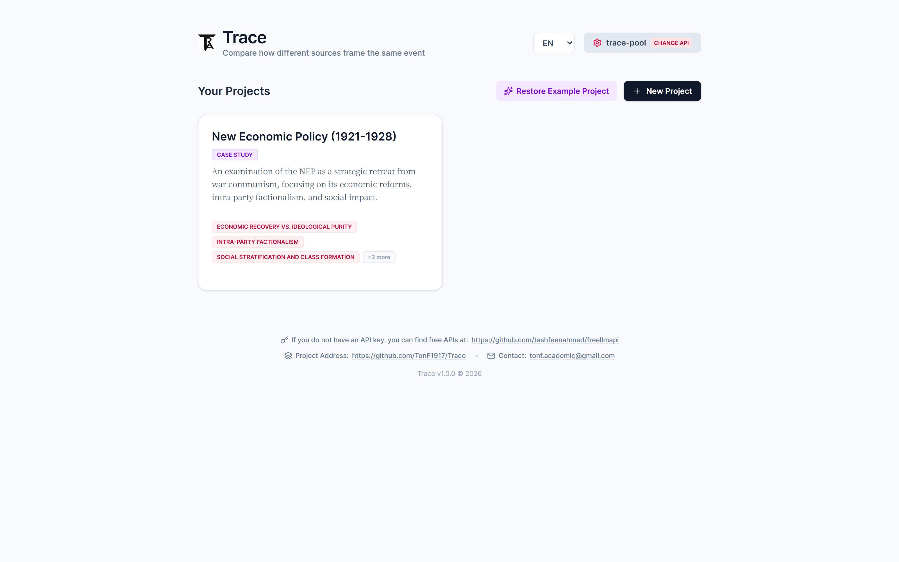
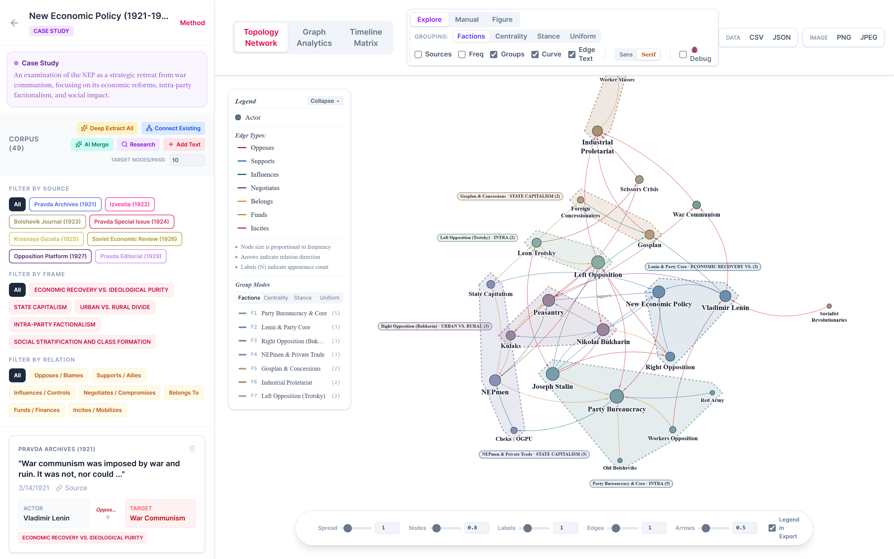
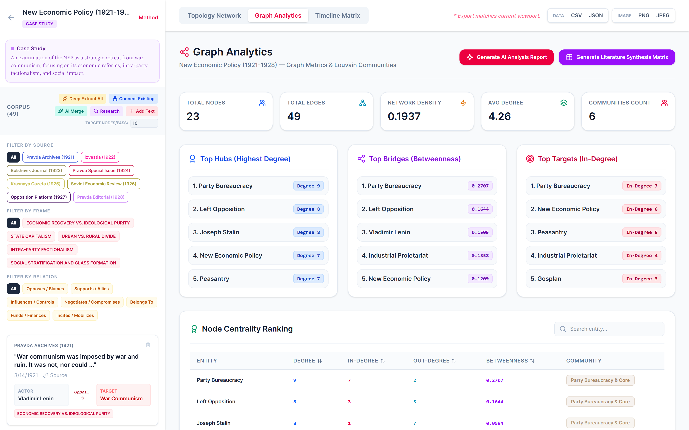

# Trace

**[English](#english) | [中文](#%E4%B8%AD%E6%96%87)**

---

<p align="center">
  
</p>
<p align="center">
  
</p>
<p align="center">
  
</p>

---

<h2 id="english">English</h2>

**Compare how different sources frame the same event.**

**Trace** is an open-source, browser-based analytical workspace for students and researchers working in history, political economy, and media analysis. It helps you extract, visualize, and compare how different institutional actors, ideological factions, or scholarly traditions build competing attribution networks and interpretive frames around the same event or research question.

### Key Features

- **Built-in Shared Pool (Capped Quota)**: For classmates and other users who have never set up an API key, Trace comes pre-configured with **Trace Built-in Pool (`Gemini 3.8 Flash High`)**. Requests go through a relay maintained by the author (`https://relay.yevgeni.eu.cc/v1/chat/completions`) to a hosted model, using a shared courtesy quota provided by the author. The quota has a usage cap (about 20M tokens in total, shared by everyone who uses the pool) and stops when it runs out. You can switch to your own provider (OpenAI, Anthropic Claude, Google Gemini, DeepSeek, SiliconFlow, OpenRouter, LM Studio, Ollama) at any time.
- **Automated Framing & Attribution Extraction**: Multi-stage LLM extraction pipeline with auto-repair JSON parsing that identifies main actors, attribution targets, narrative frames, emotional tones, and supporting quotes from the source text. Extracted quotes and relations are model output; check them against the original text before citing.
- **Interactive Blame & Attribution Topology**: Force-directed network visualization with community detection (a simplified, single-level implementation based on Louvain modularity optimization), convex hulls around detected groups, `Faction · Dominant Frame (N)` badges, and Serif/Sans typography.
- **Comparative Literature Review Preset**: One-click project ontology preset for multi-perspective literature reviews across Economic, Political, Social, Ethical, and Environmental lenses.
- **Graph Analytics & Centrality Metrics**: Network Density, Average Degree, Community Count, Top Hubs (Degree), Top Bridges (Brandes Betweenness Centrality), and Top Targets (In-Degree).
- **AI Topology Briefing & Literature Synthesis Matrix**: One-click generation of Markdown analytical briefings and 5-column comparative **Literature Synthesis Matrices** with direct `.md` export. Both are AI-generated drafts and need to be checked against your sources.
- **Where Your Data Goes**: There is no external database. Projects, extracted networks, and API settings (including any key you enter) are saved in your browser's `localStorage`. When you run extraction, Research, AI Merge, or report generation, the relevant text is sent to the model provider you have selected. With the built-in pool, that text passes through the author's relay to a hosted model. If privacy matters for your material, enter your own API key (the text then goes to that provider without passing through the relay), or run a local model with Ollama or LM Studio, in which case the text never leaves your machine.
- **Bilingual Interface**: Native English (`EN`) and Chinese (`中文`) interface switching.

---

### Features Overview

#### 1. Dashboard & AI Provider Configuration
- **Built-in Pool & Custom API Switching**: Start with the built-in `trace-pool` (`Gemini 3.8 Flash High`, the author's shared courtesy quota with a usage cap), or click the top-right API badge to configure custom endpoints, API keys, models, and custom system prompts.
- **Demo Project & Project Isolation**: The built-in **New Economic Policy (1921–1928)** project is demonstration data for learning the interface (it can be restored anytime via **Restore Example Project**). Most of its "quotes" are summary sentences written for the demo, and its source labels and links are placeholders, so do not cite it as historical evidence. Create an isolated workspace for each research topic.

#### 2. Corpus Manager & 3-Stage AI Extraction Pipeline
- **Multi-Format Corpus Ingestion (`+ Add Text`)**: Paste raw archival text or drag-and-drop `PDF`, `DOCX`, `TXT`, and `EPUB` documents directly into the workspace. Long documents can be automatically segmented via AI chunk compression.
- **AI Research (`Research`)**: Generate multi-perspective background texts or summaries of historiographical viewpoints on your research topic. These texts are written by the model, not retrieved from archives or databases, and any source names attached to them may be inaccurate or invented. Use them only to find directions; they are not sources. Replace them with real documents before any analysis you intend to cite.
- **3-Stage Extraction Workflow**:
  1. **Deep Extract All**: Primary line-by-line extraction engine with auto-repair JSON parsing. Extracts `Actor`, `Target`, `Relation Type`, `Narrative Frame`, `Tone`, and `Evidence Quotes` up to your configured **TARGET NODES/PASS** density.
  2. **Connect Existing**: Second-pass relational sweep that re-reads the corpus specifically to uncover latent cross-article ties between already discovered actors.
  3. **AI Merge**: Automated entity resolution that identifies and consolidates synonymous actor labels (e.g., merging variant names or institutional aliases into a canonical node).

#### 3. Interactive Topology Network & Visual Controls
- **Three Interaction Modes**:
  - **Explore**: Hover over any corpus card to isolate its extracted claims; click any actor node to filter related evidence; click any directed edge to scroll directly to the supporting source quote in the left panel.
  - **Manual**: Drag nodes to pin them at exact coordinates (`fx`, `fy`) for custom layout arrangement; click a pinned node to release it back to the physics simulation.
  - **Figure**: Clean publication inspection mode that suppresses interactive hover popups for distraction-free figure composition.
- **Dynamic Grouping Modes (`GROUPING`)**:
  - **Factions**: Groups actors with community detection (a simplified, single-level Louvain-based pass; opposing, blaming, and inciting edges are left out of the grouping so that antagonists are not merged). Each group is drawn inside a dashed convex hull and labeled `Faction · Dominant Frame (Count)`. Group names are taken from the group's most connected members; the demo project also uses a preset list of NEP-era names.
  - **Centrality**: Colors nodes by structural network role (`Core Hubs`, `Bridge Actors`, `Periphery`).
  - **Stance**: Colors nodes by directional attribution role (`Primary Accusers / Initiators`, `Primary Blame Targets`, `Balanced / Neutral`).
  - **Uniform**: Clean monochrome academic slate styling.
- **View & Aesthetics Controls**:
  - Toggle `Sources` (document source nodes), `Freq` (appearance count badges), `Groups` (convex hulls), `Curve` (curved vs. straight edges), `Edge Text` (relation labels along edges), and `Sans / Serif` typography.
  - Fine-tune layout geometry via the bottom Aesthetics bar: `Spread` (repulsion & hull padding), `Nodes` (default `0.8`), `Labels` (default `1.0`), `Edges`, `Arrows`, and `Legend in Export`.

#### 4. Graph Analytics & Academic Synthesis Reports
- **Global & Node-Level Metrics**: Inspect Total Nodes, Total Edges, Network Density, Average Degree, and Communities Count alongside ranked cards for **Top Hubs (Highest Degree)**, **Top Bridges (Betweenness)**, and **Top Targets (In-Degree)**.
- **Searchable Centrality Table**: Sort all entities by `Degree`, `In-Degree`, `Out-Degree`, `Betweenness`, and `Community` assignment.
- **AI Analysis Report & Literature Synthesis Matrix** (AI-generated drafts; verify claims and quotes against your sources):
  - **Generate AI Analysis Report**: Combines structural network metrics and corpus quotes into a structured briefing on power dynamics and narrative divides.
  - **Generate Literature Synthesis Matrix**: Produces a 5-column Markdown comparative table (`Source / Author | Perspective & Frame | Attribution Target | Key Claim & Quote | Methodological Tension`) with one-click copy and `.md` download.

---

### Quick Start

1. **Clone the repository**:
   ```bash
   git clone https://github.com/TonF1917/Trace.git
   cd Trace
   ```
2. **Install dependencies**:
   ```bash
   cd app
   npm install
   ```
3. **Start the local development server**:
   ```bash
   npm run dev
   ```
4. **Launch the workspace**:
   Open `http://localhost:5173` in your browser, or double-click `Trace.exe` (Windows) / `Trace.command` (macOS/Linux) in the root directory.

---

### Step-by-Step Tutorial

#### Step 1: Verify AI Pool or Configure Custom API
- Out of the box, Trace connects to the **Trace Built-in Pool (`Gemini 3.8 Flash High`)** (`trace-pool` badge in the top-right corner). It uses the author's shared courtesy quota (capped at about 20M tokens across all users), so you can try Trace without an API key. Text you analyze with the pool is sent through the relay at `relay.yevgeni.eu.cc` to a hosted model.
- To use your own API key or local model, click the `trace-pool / CHANGE API` button in the top-right header, switch to **Custom Provider**, select a preset (`OpenAI`, `Anthropic`, `Gemini`, `DeepSeek`, `SiliconFlow`, `OpenRouter`, `LM Studio`, `Ollama`), enter your key/model, and click **Save Configuration**. For sensitive material, use your own key or a local model (`LM Studio` / `Ollama`); with a local model, the text stays on your machine.

#### Step 2: Create a Project or Apply the Literature Review Preset
1. On the Dashboard, click **+ New Project**.
2. **Option A — Automated Ontology Generation**: Paste a sample article, upload a `PDF`/`DOCX`/`TXT`/`EPUB` file, or enter a research topic to let the LLM automatically propose domain-specific `Narrative Frames`, `Tones`, and `Relation Types`.
3. **Option B — One-Click Comparative Literature Review Preset**: In the project setup view, click **Apply Literature Review Preset** to pre-load 5 scholarly framing lenses (`Economic & Developmental`, `Political & Governance`, `Social & Cultural`, `Ethical & Moral`, `Environmental & Technological`) and 6 academic relation types (`Attributed Responsibility`, `Institutional Constraint`, `Empirical Evidence For`, `Critique / Counter-argument`, `Stakeholder Coalition`, `Policy Directive`).

#### Step 3: Ingest Corpus & Run the 3-Stage Extraction Pipeline
1. Inside your project workspace, add sources via **+ Add Text** (paste text or drag-and-drop `PDF`/`DOCX`/`TXT`/`EPUB` files) or click **Research** to generate multi-perspective background texts (for finding directions only; they are not sources).
2. Set **TARGET NODES/PASS** (default `10`, higher values extract denser sub-claims per pass).
3. Click **Deep Extract All** to extract actors, targets, frames, and quotes from all unanalyzed texts.
4. Click **Connect Existing** to perform a second pass that links previously isolated actors across different documents.
5. Click **AI Merge** to deduplicate and unify synonymous actor names across the network.

#### Step 4: Explore & Style the Topology Network
1. Use the left sidebar to filter the network by **Source**, **Narrative Frame**, or **Relation Type**.
2. In the top toolbar, switch between **Explore**, **Manual**, and **Figure** modes, and toggle **GROUPING** between `Factions`, `Centrality`, `Stance`, and `Uniform`.
3. Adjust the bottom Aesthetics sliders (`Spread`, `Nodes`, `Labels`, `Edges`, `Arrows`) and switch between `Serif` and `Sans` typography to prepare your visual layout.

#### Step 5: Analyze Centrality & Generate Academic Reports
1. Switch to the **Graph Analytics** tab to inspect network density, degree distributions, and betweenness bridges.
2. Click **Generate AI Analysis Report** for an executive topological briefing, or click **Generate Literature Synthesis Matrix** to build a 5-column comparative table ready for inclusion in a literature review or research paper.
3. Click **Copy Markdown** or **Download .MD** to save the generated report.

#### Step 6: Export Publication Figures & Structured Data
- In the top-right toolbar, click **CSV** or **JSON** under `DATA` to export the full relational dataset with centrality and community metadata.
- Click **PNG** or **JPEG** under `IMAGE` to export a figure rendered at 4x resolution of the current viewport (uncheck **Legend in Export** in the bottom bar if you prefer a clean, legend-free figure for LaTeX/Word manuscripts).

---

<h2 id="中文">中文</h2>

**比较不同来源如何构建同一事件的叙事与归因网络。**

**Trace** 是一款开源、在浏览器中运行的叙事拓扑与文献综述分析工作台，面向历史、政治经济学与媒体分析方向的学生和研究者。它支持从多源文本中结构化提取“行动者—归因对象—叙事框架—证据引文”四元组，通过交互式网络拓扑与图论中心性指标，呈现不同机构、学派或政治派系如何围绕同一历史事件或研究议题构建不同的归因逻辑。

### 核心功能

- **内置共享算力池（有用量上限）**：为不熟悉 API 的同学预置 **Trace Built-in Pool (`Gemini 3.8 Flash High`)**。请求经作者维护的中转服务（`https://relay.yevgeni.eu.cc/v1/chat/completions`）调用托管模型，使用的是作者提供的共享福利额度：所有使用者合计约 2000 万 Token，用完即止。无需配置 API Key 即可试用；也可随时切换至自定义服务商（OpenAI、Claude、Gemini、DeepSeek、SiliconFlow、OpenRouter、LM Studio、Ollama）。
- **三阶段 AI 提取流程**：带 JSON 自动修复的解析器，支持逐篇深度提取（Deep Extract All）、跨文献关系补充（Connect Existing）与同义实体合并（AI Merge）。提取出的引文与关系是模型输出，引用前请对照原文核实。
- **交互式派系拓扑与凸包可视化**：内置社团发现（community detection，基于 Louvain 模块度优化的简化单层实现），自动绘制派系凸包（Convex Hulls）与 `派系名称 · 主导叙事框架 (节点数)` 标签，支持衬线体（Serif）/ 无衬线体（Sans）一键切换。
- **比较文献综述一键预设（Literature Review Preset）**：针对文献综述场景，一键载入经济、政治、社会、伦理、环境五大分析维度及六类归因关系。
- **图论分析与中心性度量**：计算网络密度（Density）、平均度（Avg Degree）、社群数，并按总度数（Top Hubs）、Brandes 介数中心性（Top Bridges 跨阵营枢纽）与入度（Top Targets 归因焦点）生成排名表。
- **AI 拓扑解读报告与五列文献综述矩阵**：一键生成结构化 Markdown 拓扑分析报告，以及包含 `文献来源/作者 | 视角与框架 | 归因对象 | 核心论点与原文引证 | 方法论张力` 的五列式 **文献综述对比矩阵（Literature Synthesis Matrix）**，支持一键复制与 `.md` 文件下载。报告与矩阵均为 AI 生成的草稿，需对照原始文献核实。
- **数据去向**：无外部数据库。项目、提取结果与 API 配置（包括你填写的密钥）保存在浏览器的 `localStorage` 中。执行提取、研究（Research）、实体合并或生成报告时，相关文本会发送给你所选择的模型服务；使用内置算力池时，文本经作者维护的中转服务发送给托管模型。在意隐私时，可以填写自己的 API Key（文本不再经过该中转），或使用 Ollama / LM Studio 本地模型，此时文本不出本机。
- **中英双语原生切换**：支持中文与英文界面无缝切换。

---

### 功能详解

#### 1. 仪表盘与双模式 AI 配置 (Dashboard)
- **内置算力池与自定义 API 一键切换**：默认使用 `trace-pool`（`Gemini 3.8 Flash High`，作者提供的共享福利额度，有用量上限），无需配置即可试用；也可点击右上角配置按钮切换至任意兼容 OpenAI 接口的云端或本地大模型，并支持自定义 System Prompt。
- **演示项目与项目隔离**：内置的 **新经济政策（New Economic Policy 1921–1928）** 项目是用来熟悉界面的演示数据（随时可通过 **恢复示例项目 / Restore Example Project** 一键还原）。其中多数“引文”是为演示写的概括句，来源标签与链接是占位，不能当作史料引用。每个研究课题均作为独立项目隔离存储。

#### 2. 语料库管理与三阶段 AI 提炼流水线 (Corpus & Extraction Pipeline)
- **多格式文献导入（`+ 添加文本 / Add Text`）**：支持直接粘贴档案/论文纯文本，或将 `PDF`、`DOCX`、`TXT`、`EPUB` 文件直接拖拽至工作区；针对超长文献支持 AI 分块压缩提炼。
- **AI 背景生成（`研究 / Research`）**：根据研究主题由模型生成多视角背景文本或不同学派立场概述。这些文本由模型写成，不是检索得来的文献，所附来源名称可能不准确或并不存在。它们只用来找方向，不是来源；正式分析和引用前，应换成真实文献。
- **三阶段提炼工作流**：
  1. **深度提取全部（Deep Extract All）**：核心提炼引擎，按设定的 **目标节点数/次（TARGET NODES/PASS）** 逐篇提取 `行动者（Actor）`、`归因对象（Target）`、`关系类型`、`叙事框架（Frame）`、`情感基调（Tone）` 及 `原文引证（Quote）`。
  2. **节点关联（Connect Existing）**：二次遍历语料库，专门挖掘已发现实体之间跨段落、跨文献的潜在互动与归因关系。
  3. **AI 实体合并（AI Merge）**：自动识别并合并不同文献中指代同一实体的同义名称（例如将不同表述下的同一机构或历史人物合并为标准节点）。

#### 3. 交互式拓扑网络与视觉精调控制 (Topology Network)
- **三种交互模式**：
  - **探索（Explore）**：悬停左侧文献卡片即可高亮该文献对应的局部归因网络；点击任意节点过滤相关文献；点击任意有向连线自动定位并滚动至左侧对应的原文引证卡片。
  - **手动排版（Manual）**：自由拖拽节点并将其锚定在画布指定坐标，再次点击已锚定节点即可解除锁定。
  - **出图（Figure）**：纯净学术出图预览模式，屏蔽悬停干扰弹窗，便于论文插图排版。
- **四种动态分组视图（`分组视图 / GROUPING`）**：
  - **阵营派系（Factions）**：用社团发现自动分组（基于 Louvain 的简化单层实现；“反对/指责”与“煽动/动员”类关系不参与分组，以免把对立双方并入同一派系），绘制派系虚线凸包，顶部生成 `派系名称 · 主导框架 (成员数)` 标签。派系名称取自组内连接最多的成员；演示项目另有一组针对新经济政策时期的预设名称。
  - **中心层级（Centrality）**：按节点在网络中的结构性地位（核心枢纽 Hubs、跨派系桥梁 Bridges、外围节点 Periphery）着色。
  - **归责立场（Stance）**：按归因方向（主要发起指责方、主要被归责焦点、中立平衡节点）着色。
  - **单色（Uniform）**：简约学术灰蓝单色模式。
- **视图开关与底部美学精调栏（Aesthetics Controls）**：
  - 顶部支持开关 `来源节点（Sources）`、`词频（Freq）`、`分组圈层（Groups）`、`曲线（Curve）`、`边文字（Edge Text）` 以及 `Sans / Serif` 学术字体切换。
  - 底部美学控制栏支持实时微调：`Spread`（斥力间距与圈层留白）、`节点（Nodes，默认 0.8）`、`标签（Labels，默认 1.0）`、`边（Edges）`、`箭头（Arrows）` 以及 `导出包含图例（Legend in Export）`。

#### 4. 图谱深度分析与学术综述报告生成 (Graph Analytics)
- **全局拓扑指标与三大核心榜单**：展示总节点数、总边数、网络密度、平均度数与社群数量，并列呈现 **核心枢纽榜（Top Hubs）**、**跨阵营桥梁榜（Top Bridges）** 与 **归因焦点榜（Top Targets）**。
- **节点中心性完整排名表**：支持按总度数、入度、出度、介数中心性排序与检索，并显示每个节点所属的社群标签（一般以组内连接最多的成员命名；演示项目中为预设名称，如 `Lenin & Party Core`）。
- **双模式 AI 报告生成**（均为 AI 生成的草稿，论断与引文需对照原始文献核实）：
  - **生成 AI 深度分析报告（Generate AI Analysis Report）**：结合图论指标与原文引证，撰写关于网络权力结构、核心争点与派系分化的分析报告。
  - **生成文献综述矩阵（Generate Literature Synthesis Matrix）**：一键生成五列式 Markdown 学术文献对比表（`文献来源/作者 | 视角与框架 | 归因对象 | 核心论点与原文引证 | 方法论张力`），支持一键复制 Markdown 源码或下载 `.md` 文件。

---

### 快速开始

1. **克隆本仓库**：
   ```bash
   git clone https://github.com/TonF1917/Trace.git
   cd Trace
   ```
2. **安装依赖**：
   ```bash
   cd app
   npm install
   ```
3. **启动本地服务**：
   ```bash
   npm run dev
   ```
4. **打开工作台**：
   在浏览器中访问 `http://localhost:5173`，或直接双击项目根目录下的 `Trace.exe`（Windows）/ `Trace.command`（macOS/Linux）。

---

### 完整使用教程

#### 第一步：确认内置算力池或配置自定义 API
- 启动后，系统默认连接 **Trace 内置算力池（`Gemini 3.8 Flash High`）**（右上角显示 `trace-pool` 标识）。它使用作者提供的共享福利额度（所有使用者合计约 2000 万 Token，用完即止），无需配置即可试用。使用内置池时，你分析的文本会经中转服务 `relay.yevgeni.eu.cc` 发送给托管模型。
- 如需切换自有 API Key 或本地模型，点击右上角 `trace-pool / 切换 API` 按钮，选择 **自定义服务商（Custom Provider）**，点选预设模板（OpenAI、Anthropic、Gemini、DeepSeek、SiliconFlow、OpenRouter、LM Studio、Ollama），填入密钥后保存即可。处理敏感材料时，建议使用自己的 Key 或本地模型（LM Studio / Ollama）；使用本地模型时，文本不出本机。

#### 第二步：创建研究项目或应用“文献综述预设”
1. 在仪表盘点击 **+ 新项目（New Project）**。
2. **方式 A — AI 自动构建分类学**：粘贴一段代表性文献、上传 `PDF`/`DOCX`/`TXT`/`EPUB` 文件或输入研究主题，点击生成，由 AI 自动提炼适合该议题的叙事框架（Frames）、基调（Tones）与关系类型（Relations）。
3. **方式 B — 一键应用比较文献综述预设**：在创建项目界面点击 **应用文献综述预设（Apply Literature Review Preset）**，一键载入五大跨学科框架（经济与发展、政治与治理、社会与文化、伦理与道德、环境与技术）及六类学术归因关系，快速搭建学术文献综述工作台。

#### 第三步：导入语料并执行“三阶段 AI 提炼”
1. 进入项目后，点击左侧 **+ 添加文本（Add Text）** 粘贴文本或拖拽上传 `PDF`/`DOCX`/`TXT`/`EPUB` 文档；也可点击 **研究（Research）** 让 AI 生成多立场背景文本（只用来找方向，不是来源）。
2. 调整 **目标节点数/次（TARGET NODES/PASS）**（默认 `10`，数值越大单篇提取粒度越细）。
3. 依次执行三阶段提炼：
   - 点击 **深度提取全部（Deep Extract All）**：完成全部未处理文献的初次结构化提取；
   - 点击 **节点关联（Connect Existing）**：挖掘已识别实体之间的跨文献隐藏关联；
   - 点击 **AI 实体合并（AI Merge）**：清洗并合并同义冗余实体名称。

#### 第四步：探索拓扑网络与排版精调
1. 使用左侧边栏按 **来源（Source）**、**叙事框架（Frame）** 或 **关系类型（Relation）** 动态过滤子网络。
2. 在顶部工具栏切换 **探索（Explore） / 手动排版（Manual） / 出图（Figure）** 模式，并在 **分组视图（GROUPING）** 中切换 `阵营派系`、`中心层级`、`归责立场` 或 `单色`。
3. 通过底部美学滑块调节 `Spread`、`节点`、`标签`、`边`、`箭头` 比例，选择 `Serif`（思源宋体学术衬线风格）或 `Sans` 字体。

#### 第五步：图论分析与生成文献综述矩阵
1. 切换至顶部 **图谱深度分析（Graph Analytics）** 标签页，查看全局拓扑密度、中心性排名与派系归属。
2. 点击 **生成 AI 深度分析报告** 获取网络结构解读，或点击 **生成文献综述矩阵** 自动构建五列式学术文献对比矩阵。
3. 点击 **复制 Markdown** 或 **下载 .MD 文件**，直接嵌入您的论文或研究笔记。

#### 第六步：导出出版级高清插图与结构化数据
- 在右上角 `数据（DATA）` 栏点击 **CSV** 或 **JSON**，一键导出包含节点度数、介数中心性及派系归属的完整数据集。
- 在 `图片（IMAGE）` 栏点击 **PNG** 或 **JPEG**，即可导出按 4 倍分辨率渲染的拓扑插图（若论文排版不需要图例，可在底部取消勾选 **导出包含图例 / Legend in Export**）。

---

## License

**Trace** is distributed under a **Dual License** model:

1. **GNU AGPLv3 License** (Open Source)
   - Free for personal, academic, and non-commercial use.
   - You are free to modify and distribute the code, provided that any derivative works are also open-sourced under the AGPLv3 license. (See the [LICENSE](./LICENSE) file for details).

2. **Commercial License**
   - If you wish to use Trace in a commercial product, integrate it into a closed-source service, or avoid the restrictive terms of the AGPLv3 license, you must obtain a commercial license.
   - Please contact **tonf.academic@gmail.com** to discuss commercial licensing options.

## Contact

If you have any questions or feedback, please contact: **tonf.academic@gmail.com**
